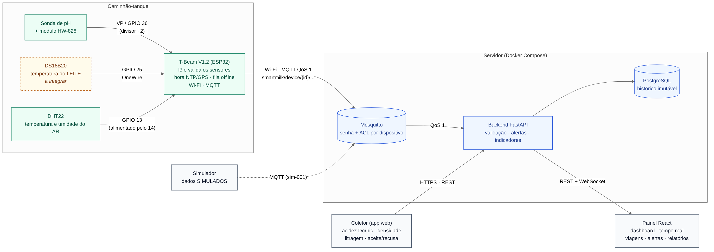

# LogLacto — Smart Milk Logistics

Plataforma de monitoramento logístico e de qualidade do leite durante o transporte:
sensores no caminhão-tanque (pH, temperatura do leite, temperatura e umidade do ar),
registro do coletor (acidez Dornic, densidade, litragem, aceite ou recusa),
histórico por viagem, alertas e indicadores.

Projeto prático em grupo — Bernardo, Francisco, Matheus, Nicolas e Zafir.



## Situação

| Etapa | | |
|-------|---|---|
| 1. Arquitetura e estrutura | ✅ | PostgreSQL + Mosquitto (senha e ACL por dispositivo) + backend com `/health`, testados |
| 2. Banco de dados | ⏳ | |
| 3. Backend, APIs e autenticação | ⏳ | |
| 4. MQTT, telemetria e simulador | ⏳ | |
| 5. Firmware da T-Beam | ⏳ | falta integrar a DS18B20 |
| 6. Frontend | ⏳ | |
| 7–9. Integração, testes, implantação | ⏳ | |

Critérios de cada etapa: [docs/architecture/etapas.md](docs/architecture/etapas.md).

## Começo rápido

Precisa do [Docker Desktop](https://www.docker.com/products/docker-desktop/).

```powershell
cd $HOME\Documents\LogLacto
Copy-Item .env.example .env      # depois troque as senhas no .env
docker compose up -d --build
```

Abra <http://localhost:8000/health>. Passo a passo completo, testes e problemas comuns:
[docs/installation](docs/installation/README.md).

## Tecnologias

| Camada | Tecnologia |
|--------|------------|
| Dispositivo | LilyGO T-Beam V1.2 (ESP32) — sensores, Wi-Fi, MQTT, GPS |
| Sensores | HW-828 (pH), DHT22 (ar), DS18B20 (leite) |
| Broker | Eclipse Mosquitto 2 |
| Backend | Python 3.12, FastAPI, SQLAlchemy 2, paho-mqtt |
| Banco | PostgreSQL 16 |
| Frontend | React, TypeScript, Tailwind CSS, Recharts, React Router, Lucide |
| Execução | Docker Compose |

## Documentação

| Documento | Conteúdo |
|-----------|----------|
| [Arquitetura](docs/architecture/README.md) | camadas, caminho de uma leitura, regras gerais |
| [Decisões (ADRs)](docs/architecture/decisoes.md) | o que foi decidido e por quê |
| [Leitura dos sensores](docs/architecture/leitura-sensores.md) | pinos, ciclo de leitura, falhas, calibração |
| [Protocolo MQTT](docs/architecture/protocolo-mqtt.md) | tópicos, payloads, garantias de entrega |
| [Modelo de dados](docs/architecture/modelo-dados.md) | tabelas previstas para a Etapa 2 |
| [Hardware](docs/hardware/README.md) | componentes e ligações propostas |
| [Instalação](docs/installation/README.md) | executar e testar no Windows |
| [API](docs/api/README.md) | endpoints atuais e previstos |

## Segurança

Senhas, tokens e certificados ficam só no `.env` e em `infrastructure/mqtt/certs/`,
que estão no `.gitignore`. Nunca coloque credenciais no código nem no frontend.
