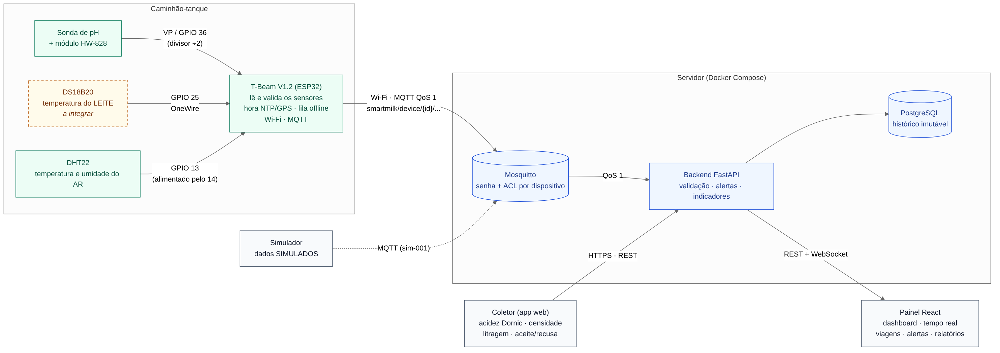

# Arquitetura do LogLacto (Smart Milk Logistics)

Plataforma de monitoramento logístico e de qualidade do leite no transporte.
Este documento descreve **o que existe, o que cada parte faz e por onde o dado passa**.
As decisões e o motivo de cada uma estão em [decisoes.md](decisoes.md).



> Fonte editável do diagrama: [arquitetura.mmd](arquitetura.mmd) (Mermaid).
> Para regenerar a imagem: `npx @mermaid-js/mermaid-cli -i arquitetura.mmd -o arquitetura.png -b white -s 2`

---

## 1. Camadas

| # | Camada | Componente | Responsabilidade | Etapa |
|---|--------|------------|------------------|-------|
| 1 | Dispositivo | T-Beam V1.2 (ESP32) + sensores | Ler pH (HW-828), ar (DHT22) e leite (DS18B20); validar a faixa física; carimbar a hora (NTP ou GPS); dar um id único a cada leitura; guardar na fila offline; publicar no MQTT | 5 |
| 2 | Mensageria | Mosquitto | Autenticar cada dispositivo; impedir que um publique no tópico do outro (ACL); guardar mensagens QoS 1 para o backend | 1 ✅ |
| 3 | Backend | FastAPI | Validar, associar à viagem, gravar, gerar alertas, calcular indicadores, servir REST e WebSocket | 3 e 4 |
| 4 | Dados | PostgreSQL | Histórico imutável de medições, cadastros, alertas, parâmetros e auditoria | 2 |
| 5 | Interface | React | Dashboard, tempo real, viagens, veículos, alertas, relatórios e tela do coletor | 6 |
| — | Teste | Simulador | Publicar leituras marcadas como SIMULADAS, como se fosse um dispositivo | 4 |

## 2. Os dois caminhos de entrada

O sistema tem **duas fontes de dado de qualidade**, como no Capítulo 8 do relatório:

**a) Telemetria contínua (automática)** — o que os sensores medem durante a viagem:

```
Sensores → T-Beam (ESP32) → (Wi-Fi/MQTT) → Mosquitto → Backend → PostgreSQL
                                                         └→ WebSocket → Painel
```

Grandezas: pH, temperatura do leite, temperatura e umidade do ar, posição GPS.

**b) Registro do coletor (manual)** — o que só se mede com equipamento de bancada:

```
Coletor no app web → (HTTPS/REST) → Backend → PostgreSQL
```

Grandezas: **acidez titulável Dornic** (titulação com NaOH 1/9N), densidade
(termolactodensímetro), litragem, amostra testemunha e decisão de aceite ou recusa.

A acidez **não** vem dos sensores: não existe sensor de acidez titulável no
projeto, e pH e acidez são grandezas diferentes (ver [decisoes.md](decisoes.md#adr-03)).

## 3. Caminho de uma leitura, passo a passo

1. A **T-Beam** lê os sensores a cada 5 s e marca em `sensor_flags` quais falharam
   ([leitura-sensores.md](leitura-sensores.md)).
2. A placa confere as faixas físicas (valor impossível vira `null`), carimba
   `measured_at` com a hora do NTP ou do GPS e gera o `msg_id`
   (`<device>-<boot>-<seq>`), que nunca se repete.
3. A leitura entra na **fila em memória flash** (LittleFS) **antes** de ser enviada.
   Só sai da fila quando o broker confirma o recebimento (PUBACK do QoS 1).
4. Sem Wi-Fi ou sem broker, a fila cresce. Quando a conexão volta, o ESP32 envia
   as pendentes **da mais antiga para a mais nova**, com o horário original e `"buffered": true`.
5. **Mosquitto** confere usuário, senha e ACL e entrega ao backend. A sessão do backend
   é persistente: se ele estiver fora, o broker guarda as mensagens.
6. **Backend** valida o esquema, confere que o `device_id` do tópico é o mesmo do
   payload, grava com `received_at` = agora e ignora duplicatas pelo par
   (`device_id`, `msg_id`).
7. A leitura é **associada à viagem** cujo intervalo saída–chegada contém o
   `measured_at` (e não "a viagem atual"), para que leituras atrasadas caiam na viagem certa.
8. As **regras de qualidade** comparam com os parâmetros vigentes e abrem, atualizam ou
   encerram alertas (com histerese, sem repetir o mesmo alerta).
9. O **WebSocket** avisa o painel. O painel mostra a idade de cada valor e
   **não chama de "tempo real" uma leitura antiga** ([seção 6](#6-regras-que-atravessam-todas-as-camadas)).

## 4. Tópicos MQTT

| Tópico | Quem publica | Conteúdo | QoS | Retido |
|--------|--------------|----------|-----|--------|
| `smartmilk/device/{id}/telemetry` | dispositivo | uma leitura | 1 | não |
| `smartmilk/device/{id}/status` | dispositivo (e o broker, pelo LWT) | online/offline, Wi-Fi, fila, estado de cada sensor | 1 | **sim** |
| `smartmilk/device/{id}/alerts` | dispositivo | falhas detectadas no próprio equipamento | 1 | não |
| `smartmilk/device/{id}/cmd` | backend | reservado (comandos futuros) | 1 | não |

Detalhes, exemplos de payload e regras de validação: [protocolo-mqtt.md](protocolo-mqtt.md).

## 5. Estrutura do repositório

```
LogLacto/
├── backend/                 API FastAPI (Python 3.12)
│   ├── app/
│   │   ├── api/routes/      rotas HTTP (controllers)
│   │   ├── core/            configuração, logs, tipos comuns
│   │   ├── database/        conexão, sessão e migrations
│   │   ├── middleware/      log de requisições, autenticação
│   │   ├── models/          tabelas (SQLAlchemy)
│   │   ├── mqtt/            conexão com o broker e consumo da telemetria
│   │   ├── repositories/    consultas ao banco
│   │   ├── schemas/         validação de entrada e saída (Pydantic)
│   │   ├── services/        regras de negócio
│   │   └── websocket/       envio em tempo real ao painel
│   └── tests/               unidade + integração
├── frontend/src/            React + TypeScript (Etapa 6)
├── firmware/
│   └── esp32/               T-Beam: sensores → fila → MQTT (Etapa 5)
├── infrastructure/
│   ├── docker/              Dockerfile do backend
│   ├── mqtt/                configuração, ACL e inicialização do Mosquitto
│   └── database/            notas de operação do banco
├── docs/                    arquitetura, API, hardware, instalação
├── docker-compose.yml       PostgreSQL + Mosquitto + backend
└── .env.example             modelo de configuração (sem segredos)
```

O prompt original previa `controllers/` e `routes/` separados, como é comum em Express.
No FastAPI a rota já é o controller, então as duas ficam em `api/routes/`, e `schemas/`
cumpre o papel de validação de entrada.

## 6. Regras que atravessam todas as camadas

- **Nada é sobrescrito.** Cada medição é uma linha nova; correções viram novos registros
  com referência ao anterior, e o original fica.
- **Toda leitura tem duas datas:** `measured_at` (quando o sensor mediu) e
  `received_at` (quando o servidor recebeu). A diferença mostra o atraso da fila offline.
- **Sem hora confiável, não entra em gráfico.** Leituras com `time_source = "none"`
  ficam gravadas mas não entram em indicadores nem séries de tempo.
- **Leitura inválida não conta.** Só leituras com `validation_status = valid` entram
  em médias, gráficos e regras de alerta.
- **Ausência de leitura não é normalidade.** Sem dado novo no prazo configurado, o
  painel mostra "sem leitura" e o backend abre alerta de comunicação. Nunca mostra o
  último valor como se fosse atual.
- **Simulado fica separado.** O simulador é um dispositivo cadastrado como simulado;
  suas leituras recebem `is_simulated = true` pelo cadastro, não pelo que o payload diz,
  e ficam fora dos indicadores reais.
- **Limites não estão no código.** Faixas de pH, temperatura e acidez são parâmetros
  configuráveis, com unidade, vigência e fonte técnica.

## 7. O que depende do hardware físico

| Item | Situação |
|------|----------|
| Sonda DS18B20 (temperatura do leite) | O grupo tem da primeira versão, mas ainda não foi ligada à T-Beam (proposta: GPIO 25). Até lá, a temperatura do leite aparece como "sem sensor" |
| Calibração do pH | Conferir com os tampões pH 4 e 7 antes dos testes (a do protótipo continua válida) |
| Wi-Fi no caminhão | Roteador 4G ou hotspot do celular. Sem isso, a fila offline guarda as leituras até a chegada |
