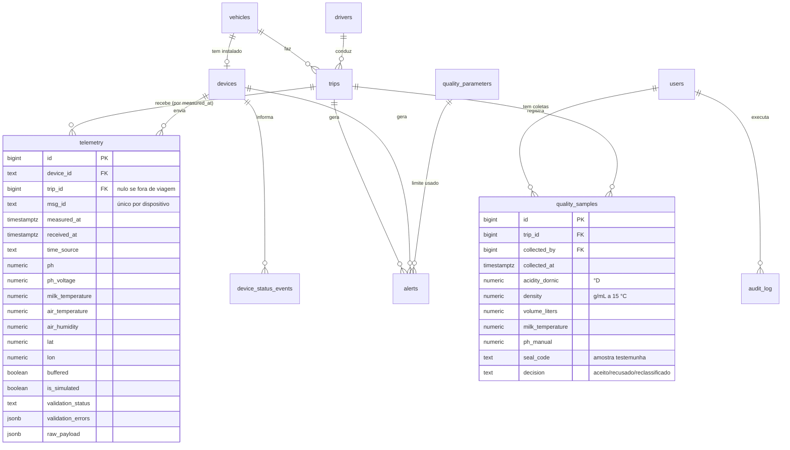

# Modelo de dados — visão preliminar

Este é o desenho de partida para a **Etapa 2**, quando as tabelas, índices e migrations
serão implementados e testados. Ele parte das tabelas do prompt e registra o que muda
e por quê.

## 1. Entidades

## 2. O que muda em relação ao prompt

| Tabela do prompt | Mudança | Motivo |
|------------------|---------|--------|
| `Telemetry` | sai `acidity`; entram `milk_temperature`, `air_temperature`, `air_humidity`, `ph_voltage`, `msg_id`, `time_source`, `buffered`, `is_simulated`, `lat`, `lon`, `raw_payload` | ADR-03, 04, 05, 07, 10. O payload bruto fica guardado para auditoria |
| `Telemetry.temperature` | dividido em leite e ar | ADR-04 |
| — | **nova** `quality_samples` (coletas) | onde a acidez Dornic, a densidade, a litragem e a decisão de aceite são registradas (ADR-03) |
| `Devices` | entram `mqtt_username`, `is_simulated`, `last_status` (jsonb) | ACL por dispositivo (ADR-08), estado de cada sensor no painel, separação de simulados |
| `Trips` | entram `code` (código da viagem) e `expected_arrival_at` | o prompt pede código da viagem e alerta de atraso |
| `Alerts` | entram `type`, `fingerprint`, `first_seen_at`, `last_seen_at`, `occurrences`, `closed_at`, `quality_parameter_id` | deduplicação e histerese: uma ocorrência contínua é **um** alerta que se atualiza |
| `QualityParameters` | entram `context` (coleta, transporte, recepção), `valid_from`, `valid_to`, `source_reference`, `needs_review` | ADR-09: vigência e fonte técnica |
| — | **nova** `device_status_events` | histórico de online/offline e do estado dos sensores |
| — | **nova** `audit_log` | quem fez o quê: login, cadastro, reconhecimento de alerta, mudança de limite |
| — | **nova** `rejected_messages` | mensagens MQTT descartadas, com o motivo |

## 3. Regras que o banco vai garantir

- `UNIQUE (device_id, msg_id)` em `telemetry` — nenhuma leitura duplicada.
- `telemetry` e `quality_samples` só recebem **INSERT** da aplicação (sem UPDATE/DELETE
  no usuário do backend). Correção = novo registro com referência ao anterior.
- `CHECK` das faixas físicas (pH 0–14, umidade 0–100…) nas colunas; as faixas de
  **qualidade** ficam em `quality_parameters`, não no esquema.
- Um veículo tem no máximo uma viagem `em_andamento` ao mesmo tempo (índice único parcial).
- Índices para as consultas do dashboard: `telemetry (trip_id, measured_at)`,
  `telemetry (device_id, measured_at DESC)`, `alerts (status, severity)`.
- Datas sempre em `timestamptz` (UTC no banco, fuso de Brasília só na tela).

## 4. Carga inicial (seeds)

- Usuário administrador (senha definida no `.env`, nunca no código).
- Parâmetros da Tabela 1 do relatório, com `source_reference = "Relatório do grupo,
  Tabela 1 (ref. IN MAPA 76/77)"` e `needs_review = true`.
- Dispositivos `esp32-001` (real) e `sim-001` (simulado), um veículo e um motorista de
  demonstração, **identificados como demonstração**.
