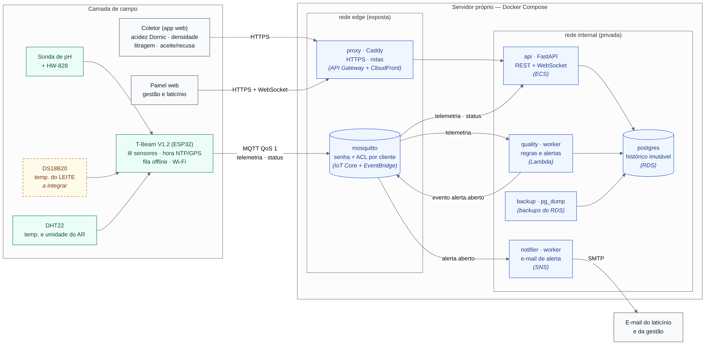

# Arquitetura de serviços — sem AWS

O Capítulo 8 do relatório descreve a arquitetura em serviços gerenciados da AWS. O
LogLacto mantém **os mesmos papéis**, mas cada serviço da AWS é trocado por um
equivalente aberto que roda em **um servidor próprio** (um computador do laboratório,
um mini-PC ou uma VPS) com Docker Compose. Decisão: [ADR-11](decisoes.md#adr-11).



## 1. Equivalência AWS → servidor próprio

| Bloco (Tabela 5) | Serviço AWS | Papel | No LogLacto | Situação |
|------------------|-------------|-------|-------------|----------|
| Rede | AWS IoT Core | Broker MQTT, um certificado por dispositivo | **mosquitto** — senha e ACL por dispositivo; TLS na 8883 para rede externa | ✅ Etapa 1 |
| Rede | Amazon API Gateway | Entrada HTTPS única para app e painel | **proxy** (Caddy) — HTTPS com certificado automático, rotas `/api`, `/ws`, `/health`, `/docs` | ✅ Etapa 1 |
| Rede | CloudFront + S3 (site) | Entrega do painel e do PWA | **proxy** (Caddy) servindo os arquivos do frontend | ✅ estrutura · painel na Etapa 6 |
| Rede | Amazon VPC | Banco sem acesso público | rede Docker **internal**; o PostgreSQL só escuta em `127.0.0.1` do servidor | ✅ Etapa 1 |
| Computação | ECS (Fargate) | API FastAPI com os módulos | **api** (FastAPI) | ✅ base · módulos nas Etapas 3 e 4 |
| Computação | AWS Lambda | Regras de qualidade a cada leitura | **quality** (worker Python, assinatura compartilhada do MQTT) | ✅ conecta e recebe · regras na Etapa 4 |
| Computação | Amazon EventBridge | Eventos de negócio (ColetaRecusada, LoteRecebido) | **mosquitto**, tópicos `smartmilk/events/...` | ✅ tópicos e ACL · eventos publicados a partir da Etapa 3 |
| Computação | Amazon SNS | SMS e e-mail de não conformidade | **notifier** (worker Python) por **SMTP**; Mailpit em desenvolvimento | ✅ e-mail funcionando · SMS fora do escopo (ver § 4) |
| Dados | RDS for PostgreSQL | Banco, telemetria particionada por mês | **postgres** 16 | ✅ Etapa 1 · tabelas e partições na Etapa 2 |
| Dados | Amazon S3 | Leituras brutas e laudos | leitura bruta em `raw_payload` (PostgreSQL); laudos em volume de arquivos da api | ⏳ Etapas 2 e 3 |
| Dados | Backups do RDS | Cópias automáticas | **backup** (pg_dump a cada 24 h, guarda 14 dias) | ✅ Etapa 1 |
| Segurança | Amazon Cognito | Login dos usuários | módulo de identidade da **api**: JWT + senhas com Argon2 | ⏳ Etapa 3 |
| Segurança | IAM | Permissões entre serviços | um usuário MQTT por serviço com ACL própria; usuário do banco por serviço na Etapa 2 | ✅ MQTT · ⏳ banco |
| Operação | CloudWatch | Logs e métricas | logs de cada container (`docker compose logs`), `/health` com o estado de cada serviço, healthcheck do Docker | ✅ Etapa 1 |
| Campo | Gateway LoRa | Ponte entre nós e nuvem | não usado: a T-Beam publica direto por Wi-Fi (ADR-06) | — |

## 2. Os serviços

| Serviço | Imagem | Redes | Porta exposta | Usuário MQTT | O que faz |
|---------|--------|-------|---------------|--------------|-----------|
| `proxy` | caddy:2 | edge | 80, 443 | — | Entrada única HTTP(S); encaminha a API e serve o painel |
| `api` | loglacto-backend | edge, internal | 127.0.0.1:8000 (depuração) | `backend` | REST, WebSocket, cadastros, consultas; acompanha o estado dos serviços |
| `quality` | loglacto-backend | internal | — | `svc-quality` | Recebe cada leitura; na Etapa 4 avalia os parâmetros e abre alertas |
| `notifier` | loglacto-backend | internal | — | `svc-notifier` | Transforma `alerta.aberto` em e-mail |
| `mosquitto` | eclipse-mosquitto:2 | edge, internal | 1883 (rede local) | — | Broker: telemetria dos dispositivos e eventos entre serviços |
| `postgres` | postgres:16-alpine | internal | 127.0.0.1:5432 | — | Banco de dados |
| `backup` | postgres:16-alpine | internal | — | — | Dump diário do banco em `./backups` |
| `mailpit` | axllent/mailpit | internal | 127.0.0.1:8025 | — | Caixa de e-mail de teste (só desenvolvimento) |

`api`, `quality` e `notifier` usam **a mesma imagem** e o mesmo código (`backend/`),
com comandos diferentes. Assim um modelo de dados ou uma regra é escrito uma vez só.

## 3. Como os serviços conversam

```
T-Beam ──MQTT──► mosquitto ──► quality ──(alerta)──► postgres
                     │            │
                     │            └──► smartmilk/events/alerta.aberto ──► notifier ──SMTP──► e-mail
                     │
                     └──► api ──► postgres
                           ▲
Painel / Coletor ──HTTPS──► proxy
```

- **Telemetria:** a T-Beam publica em `smartmilk/device/{id}/telemetry`. O `quality`
  recebe por **assinatura compartilhada** (`$share/quality/...`): se subirem duas
  réplicas, cada leitura vai para uma só, como várias execuções de uma Lambda.
- **Eventos de negócio** (`smartmilk/events/...`): publicados pela `api` e pelo `quality`,
  consumidos por quem precisa. Hoje: `alerta.aberto` → `notifier`. Previstos:
  `coleta.recusada` e `lote.recebido` (Capítulo 8).
- **Estado dos serviços:** cada worker publica, retido, em
  `smartmilk/services/{nome}/status`, com Last Will. A `api` mostra tudo em `/health`
  e responde 503 se um serviço obrigatório cair.

A ACL de cada um está em `infrastructure/mqtt/acl.template`. Um dispositivo não
consegue publicar eventos de alerta (não dispara e-mails falsos), e o `notifier`
não lê telemetria.

## 4. O que fica diferente da AWS

| Na AWS | Aqui | Consequência |
|--------|------|--------------|
| Escala sozinha | Um servidor | Suficiente para dezenas de caminhões. Para mais, sobem réplicas do `quality` e do `notifier` (a assinatura compartilhada já permite) |
| Alta disponibilidade gerenciada | Se o servidor cair, tudo para | A fila da T-Beam guarda as leituras até ele voltar (ADR-07). Para produção real: nobreak e um segundo servidor |
| Certificado por dispositivo (IoT Core) | Senha por dispositivo | Na rede externa, usar TLS na 8883. Certificado de cliente no Mosquitto é possível depois (`require_certificate`) |
| SMS pelo SNS | Só e-mail | SMS exige um provedor pago. O `notifier` foi escrito para receber outros canais (ex.: Telegram, ntfy) sem mudar quem publica o alerta |
| Backup gerenciado e replicado | Dump diário no mesmo servidor | **Copiar a pasta `backups/` para fora do servidor** (HD externo, nuvem da universidade) |
| Custo por uso | Custo do servidor | Nada a pagar para rodar na sala ou num computador do laboratório |

## 5. Onde roda

- **Desenvolvimento e apresentação:** o computador de qualquer integrante, com Docker
  Desktop. A T-Beam e o computador na mesma rede Wi-Fi.
- **Produção (se houver):** um mini-PC ou uma VPS com Linux e Docker, com um domínio
  apontando para ele. Basta trocar `SITE_ADDRESS` no `.env` para o domínio, e o Caddy
  emite o certificado HTTPS.
